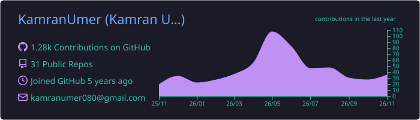
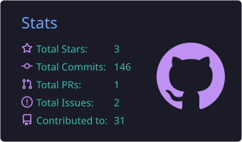
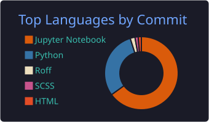
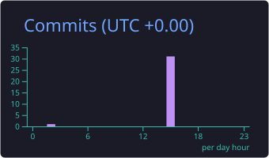
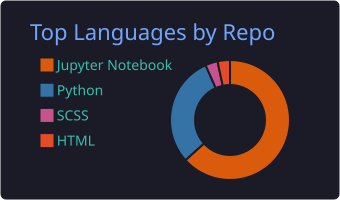

<!-- Header -->
<p align="center">
  
</p>

<p align="center">
  <a href="https://github.com/KamranUmer">
    
  </a>
</p>

<p align="center">
  <a href="https://www.linkedin.com/in/kamran-umer-5852b0214"></a>
  <a href="https://www.kamranumer.com/"></a>
  <a href="mailto:kamranumer080@gmail.com"></a>
</p>

---

## 👋 About me

```python
class KamranUmer:
    role       = "AI-Backend Engineer @ CCRIPT Agency"
    experience = "4+ years"
    location   = "Islamabad, Pakistan 🇵🇰"

    builds     = ["LLM apps & RAG", "AI agents", "computer vision", "FastAPI / Flask backends",
                  "cloud deployments"]
    learning   = "robotics & mechatronics → github.com/KamranUmer/ROBO-TOBO"

    def say_hi(self):
        return "I turn AI models into products people can use. Now I'm teaching them to move. 🤖"
```

## 🛠️ Tech stack

<p align="center">
  <br>
  
</p>

<p align="center">
  
  
  
  
  
  
  
  
  
  
  
  
</p>

## 🚀 Featured projects

<table>
<tr>
<td width="50%" valign="top">

### 🤖 [ROBO-TOBO](https://github.com/KamranUmer/ROBO-TOBO)
Learning mechatronics in public: every chapter of *Mechatronics System Design* turned into Python simulations, then built on real hardware.<br>
  

</td>
<td width="50%" valign="top">

### 🩺 [DoctorConnectAI](https://github.com/KamranUmer/DoctorConnectAI)
RAG chatbot that recommends doctors in Pakistan by city, condition, budget and gender preference.<br>
  

</td>
</tr>
<tr>
<td width="50%" valign="top">

### 📣 [AI Social Media Campaign Manager](https://github.com/KamranUmer/social-media-campaign)
Audience analysis, Gemini-generated posts and images, and performance tracking in one dashboard.<br>
  

</td>
<td width="50%" valign="top">

### 🩻 [PNS Detection · YOLOv5](https://github.com/KamranUmer/YoloV5_pns)
Custom-trained detector for medical X-rays, mAP@0.5 = 0.914, with a [YOLO-NAS version](https://github.com/KamranUmer/yolo_nas) and a [Streamlit app](https://github.com/KamranUmer/streamlitApp_for_Yolov5_pns).<br>
  

</td>
</tr>
<tr>
<td width="50%" valign="top">

### 🌿 [HortiCure](https://github.com/KamranUmer/HortiCure)
Plant disease detection from leaf photos (96.7% validation accuracy) with an AI treatment assistant.<br>
 

</td>
<td width="50%" valign="top">

### 🧠 [Abstractive Question Answering](https://github.com/KamranUmer/abstractive-question-answering)
Retrieval-augmented QA over 50,000 Wikipedia passages: MPNet retriever, Pinecone, BART answer generator.<br>
 

</td>
</tr>
</table>

## 📊 GitHub stats

<p align="center">
  
</p>
<p align="center">
  
  
</p>
<p align="center">
  
  
</p>

## 🐍 Contribution snake

<p align="center">
  <picture>
    <source media="(prefers-color-scheme: dark)" srcset="https://raw.githubusercontent.com/KamranUmer/KamranUmer/output/github-snake-dark.svg">
    <source media="(prefers-color-scheme: light)" srcset="https://raw.githubusercontent.com/KamranUmer/KamranUmer/output/github-snake.svg">
    
  </picture>
</p>

<!-- Footer -->
<p align="center">
  
</p>
